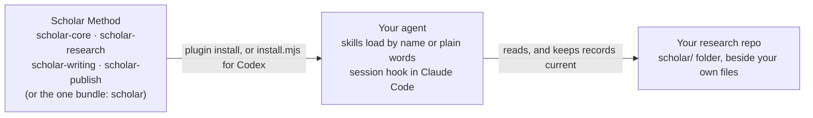
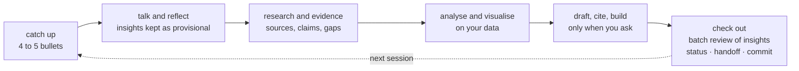

# Scholar Method

**A Claude Code and Codex research companion for a thesis, a paper or a review, with a working style that never loses your thread and never invents your findings.**

Scholar Method gives an AI coding agent a careful way to work with a researcher. It helps you think aloud, find and
read secondary sources, map claims to evidence, analyse the data you supply, draw evidence-linked figures, check
citations and build the manuscript. It keeps the record of your investigation in plain files in your own repository,
so any session, on any machine, in either agent, can pick up where you stopped.

It is for PhD scholars, paper authors and reviewers. It is scholar-led, not a ghostwriter: you own the questions, the
interpretations and every final claim. The agent never writes your thesis for you.

## Contents
- [What you can do with it](#what-you-can-do-with-it)
- [How it works](#how-it-works)
- [The packs](#the-packs)
- [Install](#install)
- [Quick start](#quick-start)
- [The words you'll use](#the-words-youll-use)
- [Example conversations](#example-conversations)
- [Integrity and writing rules](#integrity-and-writing-rules)
- [What a project looks like](#what-a-project-looks-like)
- [Citation styles and Quarto](#citation-styles-and-quarto)
- [Make it yours](#make-it-yours)
- [Harvest and contributing](#harvest-and-contributing)
- [Roadmap](#roadmap)
- [FAQ](#faq)
- [Studio Method](#studio-method) · [Licence](#licence)

## What you can do with it

| You want to... | Scholar Method... |
|---|---|
| **Talk an idea through** | listens to half-formed thoughts, says them back faithfully, offers a rival explanation and keeps them as provisional insights. It does not turn a conversation into a chapter |
| **Find secondary sources** | searches where it is allowed, says what it could not search and registers each lead with its provenance and a read status. A lead is never cited as verified |
| **Map claims to evidence** | records each claim with the page or figure that supports it, adds sources that contradict it and shows gaps ("no verified support for X") |
| **Analyse your data** | inspects your data first, states method and assumptions before any result, saves a reproducible script and reports null results too |
| **Draw evidence-linked visuals** | makes a chart, timeline, network or diagram with a provenance record, caption and alt text, so every figure traces to its inputs |
| **Draft in your voice** | writes proposed prose only when you ask, from your approved argument, with gap markers where evidence is thin |
| **Check citations and style** | checks that every citation resolves and supports its sentence; switches the citation style (APA 7 is the default) without retyping the text |
| **Build the manuscript** | runs preflight checks, then your project's own Quarto, Word or PDF build |
| **Keep continuity** | `catch up` resumes from your handoff; `check out` reviews the session's insights with you, updates status and handoff and commits locally |
| **Carry lessons forward** | `harvest` offers reusable, anonymised lessons to the method, after your review |

## How it works

### The pieces


- **The `scholar/` folder.** A small visible folder in your repo: a config file, a project map and folders for
  insights, claims and visuals. It sits beside your own files and never replaces them.
- **The scripts.** Small Node programs, nothing to install, that the agent runs for you. See
  [the commands](#the-commands-behind-the-words-for-power-users).
- **The session hook.** In Claude Code, a quiet hook tells the agent this is a Scholar project and names pending
  harvest proposals. Elsewhere it says nothing. Codex has no hooks; `catch up` does the same job there.

### A session


1. **Catch up.** Four or five bullets from your handoff: where you stopped, which insights wait for your decision,
   which harvest proposals are pending.
2. **Talk, research, visualise.** Say your thoughts; find and map sources; look at your data. The agent keeps a short
   private list of the ideas it hears.
3. **Check out.** The agent shows that list. For each idea you say keep, edit, defer or discard, and only kept ideas
   become records. Then it updates your status and handoff, validates the records and commits locally. Nothing is
   pushed without your yes.

### The first run
Open your research repo and say **`scholar start`**. The agent reads the repo (read-only), then says what it found: "It seems you are
working on a PhD thesis", with its reasons. You confirm, correct or define the project. It then says back, in 25
lines or fewer, what it understood, proposes which of your files plays which role, and asks. On your yes it adds, on a
branch, a `scholar/` folder and a short section in `AGENTS.md` or `CLAUDE.md`, then checks for Humanizer and Studio
Method (asked, never silent).

Nothing is written before your yes. Only your answer about the kind of project is recorded (thesis, journal paper,
conference paper, article, review, book, proposal or your own description). The next questions follow the kind: a
thesis asks about university rules and approvals, a journal paper about the target journal, a review about its protocol.

### What stays yours
- **It never overwrites.** It maps your existing status, handoff, registers, bibliography and drafts to roles
  instead of making copies. `check out` edits your own handoff in place.
- **Your rules win.** Institution and venue rules first, then your accepted proposal and recorded decisions, then
  your style guide, then your optional writing profile, then Scholar defaults, then third-party tools such as
  Humanizer. If your repo has its own session steps, they override Scholar's.
- **Adoption is a branch.** You review the diff. Merging is your call.

## The packs

Skills load on demand (the words are [below](#the-words-youll-use)). In Claude Code they appear namespaced, for example `scholar-core:catch-up`.

### `scholar-core`: the way of working (every project)
| Skill | What it does |
|---|---|
| **scholar-contract** | The standing rules: partnership, evidence integrity, approvals, how to talk |
| **scholar-start** | Read a repo first, name the project type, map it, adopt without overwriting, check for Humanizer |
| **catch-up** | A 4 to 5 bullet snapshot of where you left off, then a choice |
| **check-out** | Close a session: review insights, update status and handoff, validate, commit locally |
| **harvest** | Offer reusable, anonymised lessons to the method, after your review |
| **forge** | For the method's maintainer: add or improve a skill, or apply a harvest proposal |

### `scholar-research`: inquiry and evidence
| Skill | What it does |
|---|---|
| **reflect** | Think aloud: mirror the idea, rival explanations, links to your records, provisional capture |
| **research** | Find and read secondary sources, register them with provenance and read status |
| **evidence** | Map claims to sources and questions, show gaps, build a relationship graph |
| **analyse** | Transparent analysis of data you supply, assumptions stated first |
| **visualise** | Evidence-linked chart, network or diagram with a provenance record |

### `scholar-writing`: drafting and review
| Skill | What it does |
|---|---|
| **draft** | Evidence-gated prose from your approved argument; also reviewer responses and reuse provenance |
| **voice-review** | Prose linter, style review, optional Humanizer pass behind a fact guard |
| **cite** | Every citation resolves and supports its sentence; switch or convert the citation style |

### `scholar-publish`: from manuscript to submission
| Skill | What it does |
|---|---|
| **build** | Preflight checks, then the project's own Quarto, Word or PDF build |
| **submission-check** | Pre-submission checklist for a journal, conference or university, from the venue's own instructions |

## Install

### Requirements
- [Claude Code](https://docs.claude.com/en/docs/claude-code) with plugin support, or Codex, or both.
- Node.js 18 or newer for the scripts. There is nothing to `npm install`.
- Optional: [Quarto](https://quarto.org/docs/get-started/) if you want builds. Everything else works without it.

### Claude Code
In Claude Code, any project:
```
/plugin marketplace add rajeevScorpion/scholar-method
/plugin install scholar@scholar-method
```
`scholar` is a bundle: one install brings all four packs through plugin dependencies. To pick packs instead, install
any of `scholar-research`, `scholar-writing` or `scholar-publish`; each pulls in `scholar-core` itself. Claude Code
asks where to install (for you, for a shared project or local only); choose the scope that suits you. Restart
Claude Code, then check with `/plugin`.

To test from a local checkout, pass its folder to `/plugin marketplace add` instead:
```
/plugin marketplace add ./scholar-method
```

### Codex
Clone this repo, then from the clone:
```
node install/install.mjs --agent codex --project <your-research-repo>   # skills in <repo>/.agents/skills
node install/install.mjs --agent codex --global                         # ~/.codex/skills if it exists, else ~/.agents/skills
```
Options: `--packs core,research,writing,publish` (default all), `--dry-run` (changes nothing), `--target <dir>` (a
folder you name) and `--uninstall`. Collision safety: each copy is marked with `.scholar-method.json`; the installer
replaces only folders it owns and refuses to overwrite a same-named folder it does not. It prints the `AGENTS.md`
snippet that adoption adds, and does not write it.

### Update and remove
| | Claude Code | Codex |
|---|---|---|
| **Update** | `/plugin marketplace update scholar-method` (dependencies follow) | `git pull` in the clone, then run the same install command again |
| **Remove** | `/plugin uninstall scholar@scholar-method`, then the packs | the same command with `--uninstall` |

### Recommended extras
- **Humanizer** ([blader/humanizer](https://github.com/blader/humanizer)) is an optional editing helper that Scholar
  Method does not bundle. `scholar start` checks for it and asks you, per project, before installing anything (default:
  this project only). The agent re-reads Humanizer's own README first, because its commands change. As last checked:
  Claude Code `/plugin marketplace add blader/humanizer` then `/plugin install humanizer@humanizer`; Codex
  `npx skills add blader/humanizer --agent codex` (add `--global` for every project).
- **Quarto** for builds. If it is missing, `doctor` prints the official route
  (Windows: `winget install --id Posit.Quarto`) and the agent asks you first. Nothing is ever installed for you.

## Quick start

**An existing thesis or paper repo:**
1. Install (above).
2. Open Claude Code or Codex in the repo and say **`scholar start`**, or paste the prompt in [ADOPT.md](ADOPT.md).
3. Read what it says back, correct it, and say yes to the small `scholar/` folder.

**A new project:** make an empty folder, open your agent in it, say **`scholar start`**, and choose the kind of
project from the list (or describe your own). It creates only what you want.

**Every session after that:** start with **`catch up`**, end with **`check out`**.

Guides: [adopting an existing thesis](docs/ADOPTING-AN-EXISTING-THESIS.md), [adopting a paper](docs/ADOPTING-A-PAPER.md).

## The words you'll use

Plain language always works. These words are shortcuts, never a required vocabulary. British and Indian spellings
are the house style; US spellings work too (analyse or analyze, visualise or visualize).

| Say | What happens |
|---|---|
| **scholar start** | Read the repo, name the project type, say it back, map your files, adopt without overwriting |
| **catch up**, **check in** | 4 to 5 bullets from your handoff, open insights and pending harvest, then continue / start new / close loose ends |
| **check out**, **wrap up** | Review the session's insights with you, update status and handoff, validate, commit locally, give a starter line |
| **reflect**, or just talking | Mirror the idea, offer a rival view, link it to your records, keep it as a provisional insight |
| **research** | Find and read secondary sources; register them with provenance and read status |
| **evidence**, **map this to the questions** | Link claims, sources and questions; show the gaps |
| **analyse** | Transparent analysis of data you supplied, with assumptions stated first |
| **visualise**, **chart it**, **map it** | An evidence-linked figure with a provenance record |
| **draft** | Proposed prose from your approved argument. Only when you ask |
| **voice review**, **lint this** | Lint prose and review style without rewriting unasked |
| **cite**, **check my citations** | Check each citation resolves and supports its sentence |
| **change the style to MLA** | Plan the switch, then apply it on your yes; propose citekeys for hand-typed citations |
| **build** | Preflight, then your project's own Quarto, Word or PDF build |
| **submission check** | Walk the pre-submission checklist for your venue |
| **harvest** | Offer reusable lessons to the method; privacy-scanned, approved by you, nothing pushed |
| **forge** | For maintainers: turn an approved proposal or a workflow into a skill |

The shared glossary lives in
[`glossary.md`](plugins/scholar-core/skills/scholar-contract/references/glossary.md).

## Example conversations

These topics are invented, only to show the manner.

**1. A hunch, captured with a rival explanation. No draft is produced.**
> **You:** I have a hunch that late buses in the evening are linked to rainfall.
>
> **Agent:** So you suspect rain slows evening services, and you are not yet sure it is rain rather than something
> that happens at the same time. A rival explanation: evening roadworks that are more likely on the days it rains.
> Nothing in your records speaks to this yet. A good first test would be a day-by-day comparison of delays with
> rainfall. I am keeping this as a provisional idea. Want me to look for published work, or set up the comparison?

At check-out it is shown to you in a short list. You say keep, and it becomes an insight marked as a hypothesis with
no evidence yet.

**2. Switching citation style from APA 7 to MLA.**
> **You:** Change the style to MLA.
>
> **Agent:** Your project uses APA 7 (`apa.csl`). MLA 9 needs a style file I must download from the official CSL
> repository. May I? The plan: set `csl:` in `_quarto.yml` and record `mla-9` in `scholar.json`. Your text does not
> change, because citations are citekeys. You also have 3 hand-typed citations. Proposal:
>
> | Where | Original | Proposed | Confidence |
> |---|---|---|---|
> | ch2.qmd:41 | (Rao, 2019, p. 4) | `[@rao2019, p. 4]` | exact |
> | ch2.qmd:58 | Lee (2018) | `@lee2018` | exact |
> | ch3.qmd:12 | (Smith, 2020) | two entries fit | ambiguous |
>
> I will apply only the exact ones and leave the rest to you.

**3. A fresh session, days later.**
> **You:** catch up
>
> **Agent:**
> - Last session: you compared the bus-delay log with the rainfall record and stopped before checking weekends.
> - One idea waits for your decision: INS-0001, a **hypothesis** that rain slows evening buses. No evidence linked yet.
> - Rival to keep in view: evening roadworks.
> - No harvest proposals pending.
> - Next: add the weekend rows, or look for published work. Say which.

## Integrity and writing rules

The full rules are in the `scholar-contract` skill. In brief:

- **Never fabricate.** No invented sources, quotations, data or results.
- **Leads versus verified.** A source the agent found is a lead until it has been read. Only verified support can
  back a claim.
- **A hypothesis stays a hypothesis.** Your approval is not evidence. An accepted insight still says "no evidence yet"
  until real evidence is linked.
- **Visuals are claims.** Every figure traces to its inputs. Observed and hypothesised, available and target sample,
  co-occurrence and cause are kept visibly apart.
- **APA 7 by default.** A journal's or university's rules win, then a decision you record, then APA 7.
- **A writing profile is optional.** Defaults are plain: no dashes in your prose, no Oxford comma, Indian or British
  spelling, no contractions, no generic AI phrasing. All are switches in `scholar.json`.
- **A fact guard for any edit pass.** Before and after a Humanizer pass (or any edit), `fact-guard.mjs` compares
  numbers, citations, quotations, DOIs, names and your protected terms, and flags anything lost or changed.
- **Ask before anything outward.** Pushing, publishing, installing or sharing needs your yes.

## What a project looks like

```
your-research-repo/
├── AGENTS.md or CLAUDE.md          # + a short "Scholar Method" section
├── scholar/
│   ├── scholar.json                # machine config, map of your files, writing and harvest settings
│   ├── PROJECT_MAP.md              # the same map, for people
│   ├── insights/  claims/  visuals/   # INS-0001, CLM-0001, VIS-0001 records
│   ├── sources/                    # only if you have no source register
│   ├── STATUS.md HANDOFF.md DECISIONS.md   # only if you have no equivalent
│   └── harvest/                    # pending proposals and a declined log
└── your own status, handoff, registers, drafts, bibliography ...   (untouched)
```

The folder is visible on purpose: some agent search tools skip hidden folders. If you already have a source
register, visual ledger or ID scheme, Scholar points to it and reuses your IDs instead of making a parallel one.
Design notes: [docs/ARCHITECTURE.md](docs/ARCHITECTURE.md). What was tested, and what was not:
[docs/validation/RESULTS.md](docs/validation/RESULTS.md).

### The commands behind the words (for power users)

The agent runs these for you. Paths are from a checkout of this repo; installed copies sit inside the plugin or skill
folder, which the agent finds itself. Run them as `node plugins/<path> ...`.

| Script | Commands |
|---|---|
| `scholar-core/skills/scholar-start/scripts/scholar.mjs` | `init --dry-run` (map of your files, nothing written); `init --apply [--kind <kind>] [--describe "..."]`; `detect`; `doctor` (Quarto, Humanizer, Studio Method); `validate`; `new insight/claim/source/visual --title "..."`; `status`. Kinds: thesis, journal-paper, conference-paper, article, review, book, proposal, other |
| `scholar-research/skills/evidence/scripts/graph.mjs` | `--root . [--out scholar/visuals/evidence-map]`: evidence map from links in your records |
| `scholar-research/skills/visualise/scripts/render.mjs` | `<spec.vl.json> [--svg] [--sidecar VIS-0001]`: Vega-Lite spec to an HTML viewer |
| `scholar-writing/skills/voice-review/scripts/lint-prose.mjs` | `<files> [--strict]`: prose linter, report only |
| `scholar-writing/skills/voice-review/scripts/fact-guard.mjs` | `<before> <after> [--strict]`: protected items before and after an edit |
| `scholar-writing/skills/cite/scripts/check-citations.mjs` | `--root . [--bib refs.bib] [--strict]`: citekeys, locators, claim status |
| `scholar-writing/skills/cite/scripts/style.mjs` | `status, use, fetch, fields, convert, narrative` (below) |
| `scholar-publish/skills/build/scripts/preflight.mjs` | `--root . [--submission] [--strict]`: build preflight, never builds |
| `scholar-core/skills/harvest/scripts/harvest.mjs` | `new, check, approve, decline, list, bundle, promote` (see Harvest) |

## Citation styles and Quarto

Write citations once, as Pandoc citekeys (`[@key, p. 12]`, `@key`), with sources in a `.bib` or CSL-JSON file. The
style is one setting, the `csl:` file in your Quarto or Pandoc config, so changing style means swapping that file,
not retyping the text. **APA 7 is the default.** `apa.csl` is bundled. MLA 9, Chicago (author-date and notes),
Harvard, IEEE, Vancouver (NLM) or any CSL file you supply are downloaded on demand, only with your yes. Without a
`csl:` Pandoc would fall back to Chicago author-date, so `status` and the build preflight warn when none is set.

```
STYLE=plugins/scholar-writing/skills/cite/scripts/style.mjs
node $STYLE status --root .                    # style in use, bibliography, Quarto
node $STYLE use mla-9 --root .                 # plan only
node $STYLE use mla-9 --root . --apply         # do it
node $STYLE fields mla-9 --root .              # bib fields that style still needs
node $STYLE convert --root .                   # propose citekeys for typed "(Smith, 2020)"
```

`convert --apply` rewrites only exact matches and leaves ambiguous or unmatched ones for you; `narrative` lists wording
that depends on the style. See [the cite skill](plugins/scholar-writing/skills/cite/SKILL.md) and
[its style notes](plugins/scholar-writing/skills/cite/references/styles.md).

**Quarto.** Builds use your project's own Quarto setup. `scholar.mjs doctor` reports the Quarto version, its Pandoc
and whether PDF output is ready (Typst comes with Quarto 1.4 and later; TinyTeX is only needed for LaTeX).

## Make it yours

Edit `scholar/scholar.json` (the agent will help):
- **`capture`**: `batch` (default: ideas are reviewed with you at a pause or at check-out), `ask` (the agent asks as
  each idea comes) or `off` (only when you say "note that").
- **`writing`**: `no_dashes`, `no_oxford_comma`, `serial_comma`, `no_contractions`, `ai_register`, `spelling`
  (`indian`, `us` or `off`) and `protected_terms` for the fact guard.
- **`citation`**: `style` and `csl`, normally set through `style.mjs use`.
- **`profile.writing_profile`**: `indian-academic-english`, a path to your own profile, or null for none.
- **`harvest`**: `deny_terms` (title words, names, institution, IDs that must never leave the project) and
  `allow_domains`.

Project rules outrank defaults. If your venue wants US spelling or the serial comma, change the key and record the
decision. Your own style guide, named in `paths.style_guide`, outranks the writing profile.

## Harvest and contributing

Say **"harvest"** (or let `check out` offer it). The agent finds lessons that apply beyond your project, drops
anything specific to your study, and shows you each one. An approved proposal is a portable file in
`scholar/harvest/pending`. It gets a privacy scan against your deny terms, and only with your yes is it exported as a
bundle file or committed to a local branch of a method checkout. It never pushes and never adds a remote.

To contribute without write access, fork the repo or send a harvest bundle with an issue or pull request. See
[CONTRIBUTING.md](CONTRIBUTING.md): one skill per change, public-safe invented examples, `node --test` and
`claude plugin validate .` pass, and versions bumped in both manifests.

## Roadmap

Next up: a venue format check, a publication map (which parts of a thesis feed which papers), author-date text
citations resolved in `cite`, and an Excalidraw export helper. Full list and what is not planned (an autonomous
thesis writer, primary data collection) in [docs/ROADMAP.md](docs/ROADMAP.md).

## FAQ

**Does it write my thesis?** No. It drafts only when you ask, in your voice, from your approved argument, with gap
markers where evidence is missing. You decide every claim.

**Does it work offline?** The skills and scripts need no network. Finding sources, downloading a citation style and
the chart libraries do, and so does your agent.

**Claude Code and Codex both?** Yes, the same skills. Claude Code installs through the marketplace and gets a session
hook; Codex uses `install/install.mjs`. The records are plain files, so you can switch between them.

**Will it change my files?** Not until you say yes. `scholar start` reads first. Adoption adds a small `scholar/`
folder and a short section in `AGENTS.md` or `CLAUDE.md`, on a branch you review. Your own files are never replaced.

**Where is my data?** In your repo, as plain Markdown and JSON. Scholar Method has no servers, no telemetry and no
accounts. Your insights are never shared; only anonymised harvest proposals you approve ever leave the project.

**What if I use MLA?** Say "change the style to MLA". Your text is citekeys, so only the style file changes. A journal's
own CSL file works too.

**Can a second computer continue?** Yes. Commit and push `scholar/` and your own handoff, pull on the other machine
and say `catch up`. Agent memory is private to each machine and is never treated as shared.

**Is Humanizer required?** No. It is asked about per project and never installed silently. Without it,
`voice-review` still lints your prose.

## Studio Method

Scholar Method is derived from [Studio Method](https://github.com/aavritidesignstudio/studio-method) (MIT), a Claude
Code kit for building apps and sites. This is a separate, independent project for scholarly work. See
[NOTICE.md](NOTICE.md). Both can be installed; Scholar's adoption step shows how to keep them from colliding.

## Licence

[MIT](LICENSE) © Aavriti Design Studio. The bundled APA 7 citation style file is licensed CC BY-SA 3.0; see
[NOTICE.md](NOTICE.md). Scholar Method is an independent project and is not affiliated with Anthropic, OpenAI,
Quarto or the other tools it mentions; their names are trademarks of their owners.
